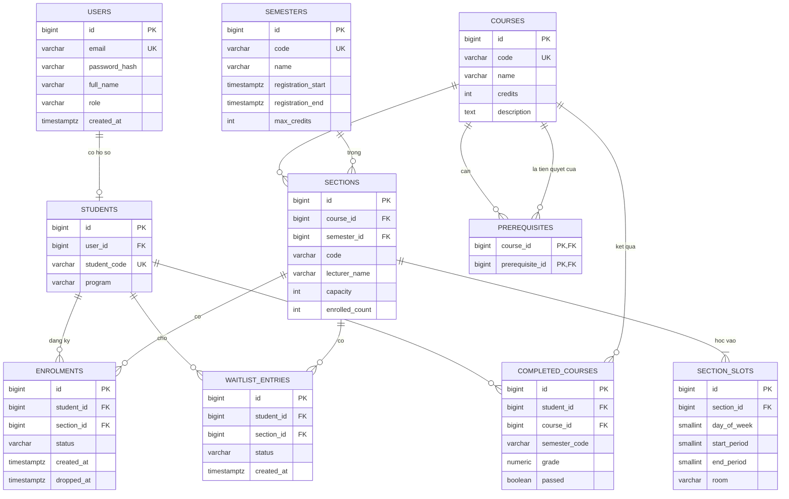

# Thiết kế cơ sở dữ liệu - Topic 6

- Người phụ trách: Tăng Hoàng Phúc (M3 - Database, Auth & Security)
- Người review: Lê Trung Bảo (M2)
- Trạng thái: bản nháp khởi đầu, người phụ trách cần rà soát, chỉnh sửa rồi mới đưa cả nhóm review
- Hệ quản trị: PostgreSQL 16

Bản ERD xuất ra PDF để nộp lưu cùng thư mục này (`erd.pdf`). Sơ đồ dưới đây là bản nguồn, GitHub hiển thị trực tiếp.

## 1. Sơ đồ ERD

## 2. Mô tả bảng

| Bảng | Vai trò | Ghi chú |
|---|---|---|
| `users` | Tài khoản đăng nhập | `role` là `STUDENT` hoặc `ADMIN`; mật khẩu lưu dạng băm |
| `students` | Hồ sơ sinh viên | Quan hệ một-một với `users` |
| `semesters` | Học kỳ | Giữ thời gian mở đăng ký và giới hạn tín chỉ |
| `courses` | Môn học | `credits` lớn hơn 0 |
| `prerequisites` | Quan hệ tiên quyết | Khóa chính gồm hai cột; mỗi dòng là một cạnh của đồ thị |
| `sections` | Lớp học phần | `enrolled_count` là số sinh viên đang `ENROLLED` |
| `section_slots` | Buổi học của lớp | Một lớp có thể học nhiều buổi mỗi tuần |
| `enrolments` | Đăng ký | `status` là `ENROLLED` hoặc `DROPPED` |
| `waitlist_entries` | Hàng chờ | `status` là `WAITING`, `PROMOTED`, `SKIPPED`, `CANCELLED`; thứ tự theo `created_at`, rồi `id` |
| `completed_courses` | Kết quả học | Dữ liệu mẫu nạp sẵn, dùng để kiểm tra tiên quyết |

## 3. Ràng buộc

| Bảng | Ràng buộc | Mục đích |
|---|---|---|
| `prerequisites` | `CHECK (course_id <> prerequisite_id)` | Môn không là tiên quyết của chính nó |
| `sections` | `UNIQUE (course_id, semester_id, code)` | Mã lớp không trùng trong một môn và học kỳ |
| `sections` | `CHECK (capacity > 0)` | Sức chứa hợp lệ |
| `sections` | `CHECK (enrolled_count >= 0 AND enrolled_count <= capacity)` | Lớp chắn cuối chống vượt sĩ số |
| `section_slots` | `CHECK (day_of_week BETWEEN 1 AND 7)` | 1 là thứ Hai, 7 là Chủ nhật |
| `section_slots` | `CHECK (start_period >= 1 AND end_period >= start_period)` | Khoảng tiết hợp lệ |
| `enrolments` | Chỉ mục duy nhất trên `(student_id, section_id)` với điều kiện `status = 'ENROLLED'` | Không đăng ký một lớp hai lần |
| `waitlist_entries` | Chỉ mục duy nhất trên `(student_id, section_id)` với điều kiện `status = 'WAITING'` | Không vào một hàng chờ hai lần |
| `completed_courses` | `CHECK (grade BETWEEN 0 AND 10)` | Điểm hợp lệ |

Hai chỉ mục duy nhất có điều kiện cho phép sinh viên hủy rồi đăng ký lại cùng một lớp mà vẫn giữ được lịch sử.

Quy tắc "mỗi học kỳ chỉ một lớp cho mỗi môn" không biểu diễn được bằng ràng buộc đơn giản,
vì môn và học kỳ nằm ở bảng `sections`. Quy tắc này do backend kiểm tra bên trong transaction đăng ký.

Đồ thị không có vòng lặp cũng không biểu diễn được bằng ràng buộc. Backend kiểm tra trước khi thêm một dòng vào `prerequisites`.

## 4. Chỉ mục

| Bảng | Cột | Dùng cho |
|---|---|---|
| `courses` | `code`, `name` | Tìm kiếm danh mục |
| `sections` | `(semester_id, course_id)` | Liệt kê lớp của một môn trong học kỳ |
| `section_slots` | `section_id` | Lấy lịch của lớp |
| `enrolments` | `(student_id, status)` | Lấy các lớp sinh viên đang học để kiểm tra trùng lịch và tín chỉ |
| `enrolments` | `(section_id, status)` | Danh sách lớp |
| `waitlist_entries` | `(section_id, status, created_at)` | Lấy người đứng đầu hàng chờ |
| `completed_courses` | `(student_id, course_id)` | Kiểm tra tiên quyết |
| `prerequisites` | `prerequisite_id` | Duyệt đồ thị theo chiều ngược |

## 5. Xử lý đăng ký đồng thời

Cách làm đề xuất (M2 và M3 cùng chốt):

1. Mở transaction.
2. `SELECT ... FROM sections WHERE id = $1 FOR UPDATE` để khóa dòng của lớp.
3. Nếu `enrolled_count >= capacity` thì rollback và trả `SECTION_FULL`.
4. Thêm dòng vào `enrolments`, tăng `enrolled_count` thêm 1.
5. Commit.

Các yêu cầu đến cùng lúc cho một lớp sẽ xếp hàng ở bước 2, nên đúng một yêu cầu lấy được chỗ cuối.
Ràng buộc `enrolled_count <= capacity` là lớp bảo vệ thứ hai: nếu code có lỗi, cơ sở dữ liệu vẫn từ chối.

Khi một sinh viên gửi hai yêu cầu cùng lúc cho hai lớp khác nhau, khóa theo lớp là chưa đủ để kiểm tra trùng lịch và tín chỉ.
Cần khóa thêm dòng của sinh viên (`SELECT ... FROM students WHERE id = $1 FOR UPDATE`) ở đầu transaction.
Luôn khóa theo một thứ tự cố định (sinh viên trước, lớp sau) để tránh khóa chết.

## 6. Dữ liệu mẫu cần có

- 2 tài khoản admin, khoảng 120 tài khoản sinh viên (đủ cho bài stress test 100 người).
- 1 học kỳ đang mở đăng ký, 1 học kỳ đã đóng.
- Khoảng 20 môn, có chuỗi tiên quyết dài 3 cấp và một môn có 2 môn tiên quyết.
- Mỗi môn 1 đến 3 lớp, có cặp lớp trùng lịch và cặp lớp liền kề nhau.
- 1 lớp chỉ còn đúng 1 chỗ, 1 lớp đã đầy và có sẵn hàng chờ.
- Kết quả học: sinh viên đã đạt, sinh viên rớt môn tiên quyết, sinh viên chưa học.

## 7. Các điểm cần thống nhất

1. Giữ cột `enrolled_count` (đọc nhanh, phải cập nhật trong transaction) hay đếm trực tiếp từ `enrolments` mỗi lần.
2. Phiên đăng nhập lưu ở đâu: bảng `sessions` trong PostgreSQL hay bộ nhớ của server.
3. Dùng công cụ migration nào, hay viết file SQL đánh số trong `backend/db/migrations/`.
4. Có cần bảng ghi lại lịch sử thao tác đăng ký và hủy môn để đối chiếu khi demo không.
5. Giới hạn tín chỉ đặt theo học kỳ (như bản nháp) hay theo từng sinh viên.
