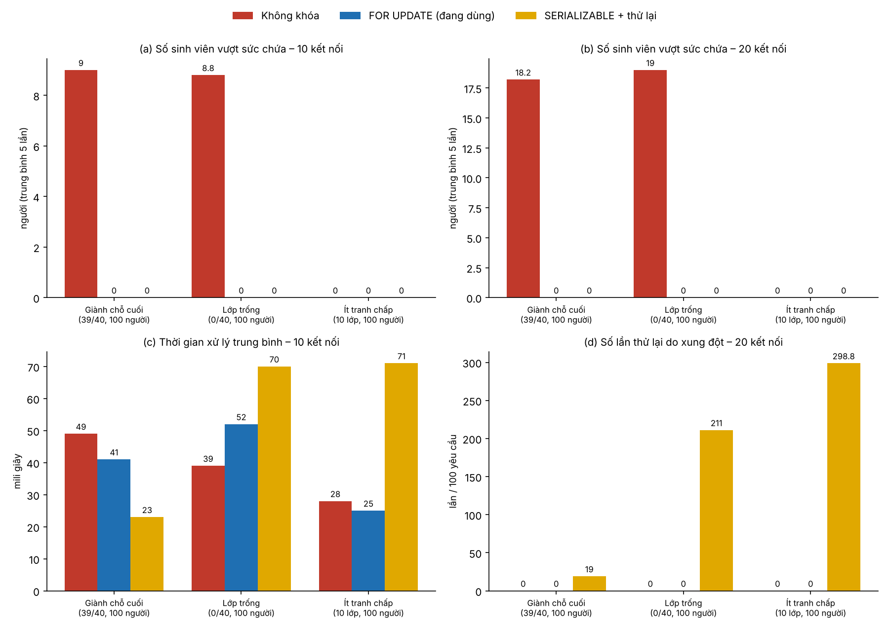

# Cải tiến 3: So sánh các cách chống tranh chấp khi đăng ký

## Câu hỏi

Hệ thống chống "bán lố" chỗ bằng `SELECT ... FOR UPDATE` (khóa dòng của lớp) trong một
transaction. Stress test #63 đã chứng minh cách này **đúng** qua API thật. Thí nghiệm này trả lời
câu hỏi tiếp theo: **vì sao chọn cách này** mà không phải cách khác?

| Cách | Mô tả |
|---|---|
| **Không khóa** | `READ COMMITTED` (mặc định của PostgreSQL), đọc sĩ số rồi ghi, không khóa gì |
| **FOR UPDATE** (đang dùng) | `READ COMMITTED` + `SELECT ... FOR UPDATE` trên dòng của lớp: các giao dịch cùng lớp xếp hàng |
| **SERIALIZABLE + thử lại** | Mức cô lập cao nhất, không khóa dòng; PostgreSQL tự phát hiện xung đột và hủy giao dịch (lỗi `40001`), ứng dụng phải thử lại (tối đa 10 lần) |

## Cách làm

- Script: `tests/load/lock-compare.mjs` (`npm run test:locks`), biểu đồ: `tests/load/lock-chart.py`.
- Chạy trực tiếp trên PostgreSQL 16, trong schema riêng `lock_experiment` (tự tạo, tự xóa), không
  đụng bảng thật, không qua backend, để chỉ so sánh **cách khóa**.
- Mỗi lần đăng ký làm đúng các bước như hệ thống thật: đọc sĩ số → 4 truy vấn đọc để kiểm tra điều
  kiện (giống `readFacts`) → nếu còn chỗ thì thêm dòng đăng ký và tăng `enrolled_count`.
- Bảng thí nghiệm **cố ý không có** `CHECK (enrolled_count <= capacity)` để thấy tác dụng của riêng
  cách khóa. Bảng thật vẫn có ràng buộc này làm lớp chặn cuối.
- 3 kịch bản × 3 cách × **5 lần**, mỗi lần 100 yêu cầu đồng thời, chạy với **10 kết nối** (bằng pool
  mặc định của backend) và **20 kết nối** (tải cao hơn).

| Kịch bản | Thiết lập | Kết quả đúng |
|---|---|---|
| Giành chỗ cuối | Lớp 40 chỗ đã có 39, 100 người đăng ký cùng lúc | Đúng 1 người vào |
| Lớp trống | Lớp 40 chỗ còn trống, 100 người đăng ký cùng lúc | Đúng 40 người vào |
| Ít tranh chấp | 10 lớp, mỗi lớp 40 chỗ, 100 người chia đều | Cả 100 người vào |

Dữ liệu gốc: `tests/load/results/lock-compare-pool10-*.json` và `lock-compare-pool20-*.json`.

## Kết quả

### Độ đúng (5 lần chạy mỗi ô)

| Kịch bản | Không khóa | FOR UPDATE | SERIALIZABLE |
|---|---|---|---|
| Giành chỗ cuối, 10 kết nối | **Sai 5/5**: 10 người vào lớp 1 chỗ (vượt 9) | Đúng 5/5 | Đúng 5/5 |
| Lớp trống, 10 kết nối | **Sai 5/5**: trung bình 48,8 người vào lớp 40 chỗ | Đúng 5/5 | Đúng 5/5 |
| Giành chỗ cuối, 20 kết nối | **Sai 5/5**: vượt 18,2 người | Đúng 5/5 | Đúng 5/5 |
| Lớp trống, 20 kết nối | **Sai 5/5**: 59 người vào lớp 40 chỗ | Đúng 5/5 | Đúng 5/5, nhưng **7 yêu cầu thất bại** |
| Ít tranh chấp, 20 kết nối | Đúng 5/5 | Đúng 5/5 | **Trung bình 3,4 chỗ bỏ trống** mỗi lần: 17 sinh viên bị từ chối dù lớp còn chỗ |

### Chi phí (trung bình 5 lần, 10 kết nối)

| Kịch bản | | Không khóa | FOR UPDATE | SERIALIZABLE |
|---|---|---|---|---|
| Giành chỗ cuối | thời gian TB / p95 | 49 / 77 ms | 41 / 70 ms | 23 / 36 ms |
| | số lần thử lại | 0 | 0 | 9 |
| Lớp trống | thời gian TB / p95 | 39 / 58 ms | 52 / 81 ms | 70 / 94 ms |
| | số lần thử lại | 0 | 0 | 73,8 |
| Ít tranh chấp | thời gian TB / p95 | 28 / 51 ms | 25 / 45 ms | 71 / 131 ms |
| | số lần thử lại | 0 | 0 | 139,4 |

Với 20 kết nối, SERIALIZABLE cần 211 lần thử lại (lớp trống) và 298,8 lần (ít tranh chấp) cho mỗi
100 yêu cầu; FOR UPDATE vẫn 0.

## Phân tích

1. **Không khóa thì bán lố, và càng tải cao càng lố nhiều.** Số người vượt luôn xấp xỉ
   *số kết nối − 1* (9 với 10 kết nối, 18-19 với 20 kết nối): mọi giao dịch chạy cùng lúc đều đọc
   cùng một sĩ số "còn chỗ" rồi cùng ghi. Đây là lỗi *lost update / write skew* kinh điển. Trên bảng
   thật, ràng buộc `CHECK` sẽ chặn phần vượt, nhưng sinh viên sẽ nhận lỗi 500 thay cho thông báo rõ ràng.
2. **FOR UPDATE đúng tuyệt đối, không cần thử lại, không từ chối nhầm ai.** Khóa chỉ đặt trên **một
   dòng của lớp đang được tranh**: các lớp khác nhau không chặn nhau (kịch bản ít tranh chấp nhanh
   ngang không khóa: 25 ms so với 28 ms). Cái giá là các giao dịch cùng lớp phải xếp hàng, nên kịch bản
   lớp trống chậm hơn không khóa khoảng 13 ms, chấp nhận được.
3. **SERIALIZABLE đúng nhưng đắt và khó dùng.**
   - Mọi giao dịch phải có vòng **thử lại**; quên ở chỗ nào là chỗ đó lỗi.
   - Phát hiện xung đột cả khi **không có tranh chấp thật** (kịch bản ít tranh chấp: 139-299 lần thử
     lại): PostgreSQL theo dõi các vùng dữ liệu đã đọc (khóa vị từ của SSI). Khi bảng nhỏ hoặc truy vấn
     quét nhiều dòng, vùng theo dõi rộng nên hai giao dịch không liên quan vẫn bị coi là xung đột.
   - Khi tải cao, có giao dịch thử lại hết 10 lần vẫn thất bại: **17 sinh viên bị từ chối dù lớp còn
     chỗ**. Với đăng ký học phần, đây là lỗi nghiêm trọng về công bằng.
   - Riêng kịch bản giành chỗ cuối SERIALIZABLE nhanh hơn: người thua bị hủy sớm, thử lại thì thấy lớp
     đầy và trả về ngay, không phải xếp hàng chờ khóa.

## Kết luận

| Tiêu chí | Không khóa | FOR UPDATE | SERIALIZABLE |
|---|---|---|---|
| Không bán lố | ✗ | ✓ | ✓ |
| Không từ chối nhầm khi tải cao | ✓ | ✓ | ✗ |
| Không cần logic thử lại | ✓ | ✓ | ✗ |
| Lớp khác nhau không chặn nhau | ✓ | ✓ | ✗ (xung đột giả) |

Bài toán đăng ký học phần có đúng một "điểm nóng" rõ ràng là **sĩ số của từng lớp**. Khóa đúng dòng đó
bằng `FOR UPDATE` cho độ đúng như SERIALIZABLE mà không phải trả giá thử lại hay từ chối nhầm. Kết quả
thí nghiệm **xác nhận lựa chọn thiết kế hiện tại** (xem thêm ADR về cơ chế khóa).

## Giới hạn của thí nghiệm

- Chạy trên một máy, PostgreSQL 16; số mili giây thay đổi theo máy, nhưng xu hướng giữa 3 cách giữ nguyên.
- Bảng thí nghiệm rút gọn (chỉ phần tranh chấp sĩ số), không qua HTTP và backend; thời gian đầu-cuối
  qua API thật xem ở stress test #63 (giành chỗ cuối: trung bình 234 ms, p95 344 ms, 12/12 lần đúng).
- SERIALIZABLE có thể giảm xung đột giả bằng chỉ mục và truy vấn hẹp hơn, nhưng như vậy mỗi truy vấn
  mới đều phải được rà soát lại, đúng là gánh nặng mà FOR UPDATE tránh được.
