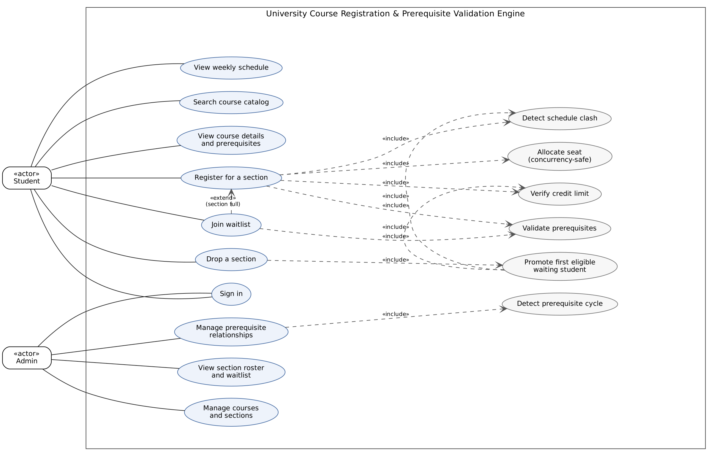
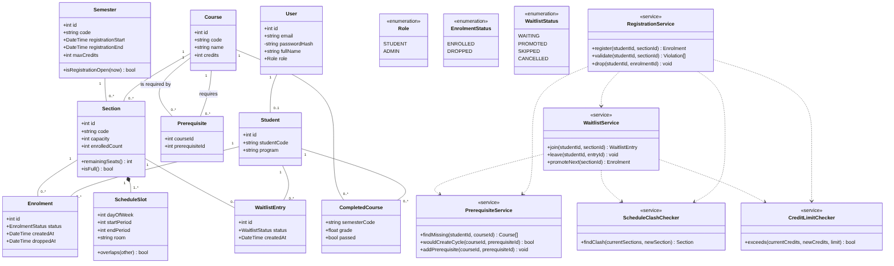
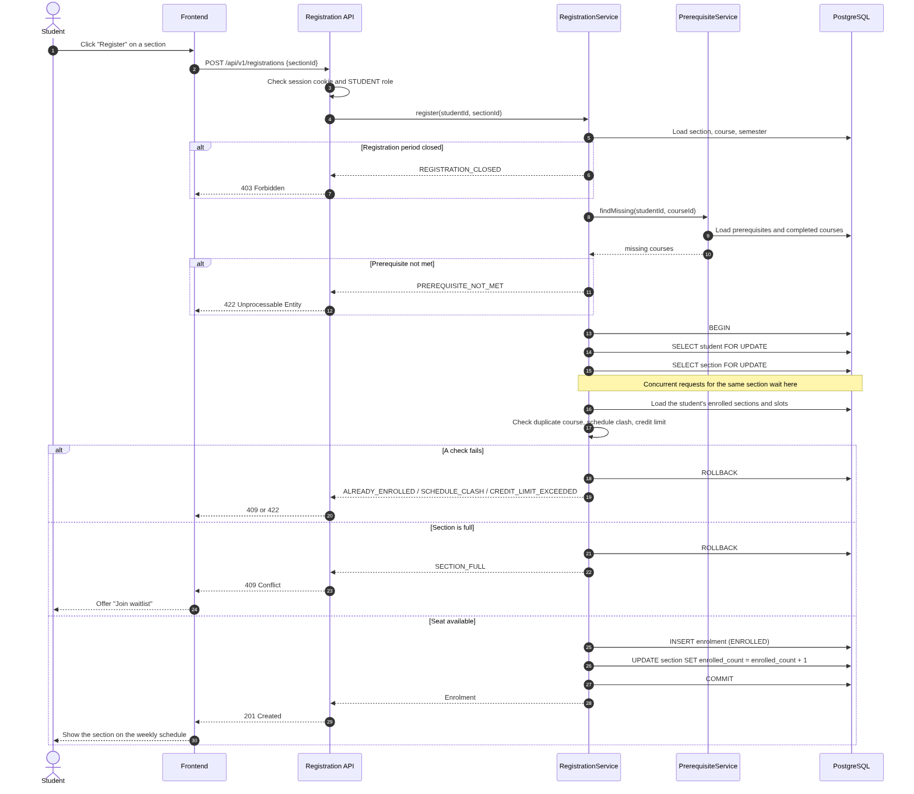
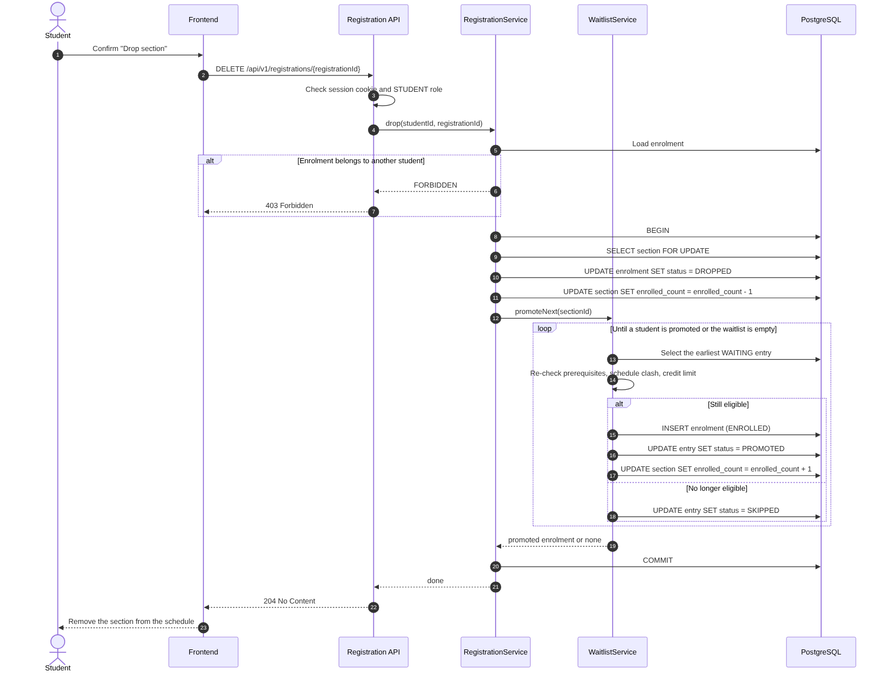

# Sơ đồ UML - Topic 6

- Trạng thái: bản nháp khởi đầu, cả nhóm cần rà soát; sửa file nguồn rồi xuất lại PDF khi thiết kế thay đổi.

| Sơ đồ | Bản nộp (PDF) | Ảnh xem nhanh | File nguồn |
|---|---|---|---|
| Use Case | [use-case.pdf](use-case.pdf) | [use-case.png](use-case.png) | `use-case.dot` (Graphviz) |
| Class | [class-diagram.pdf](class-diagram.pdf) | [class-diagram.png](class-diagram.png) | `class-diagram.mmd` (Mermaid) |
| Sequence: đăng ký lớp học phần | [sequence-register.pdf](sequence-register.pdf) | [sequence-register.png](sequence-register.png) | `sequence-register.mmd` (Mermaid) |
| Sequence: hủy môn và đẩy hàng chờ | [sequence-drop-promotion.pdf](sequence-drop-promotion.pdf) | [sequence-drop-promotion.png](sequence-drop-promotion.png) | `sequence-drop-promotion.mmd` (Mermaid) |

## Use Case



## Class



## Sequence: đăng ký lớp học phần



## Sequence: hủy môn và đẩy hàng chờ



## Cách xuất lại

```bash
# Mermaid (.mmd)
npx @mermaid-js/mermaid-cli -i class-diagram.mmd -o class-diagram.pdf --pdfFit
# Graphviz (.dot)
dot -Tpdf use-case.dot -o use-case.pdf
```
